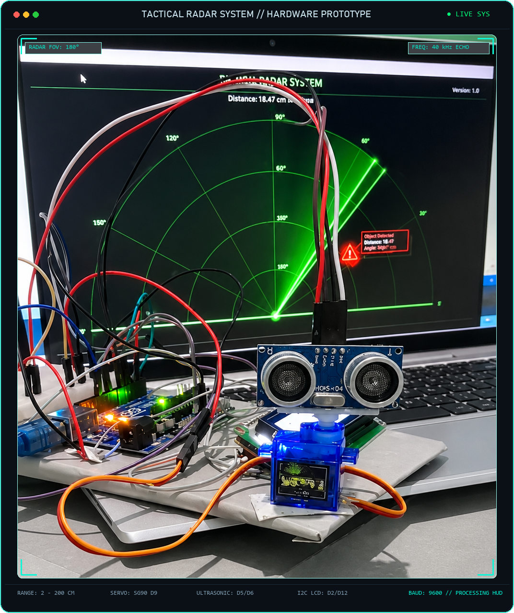
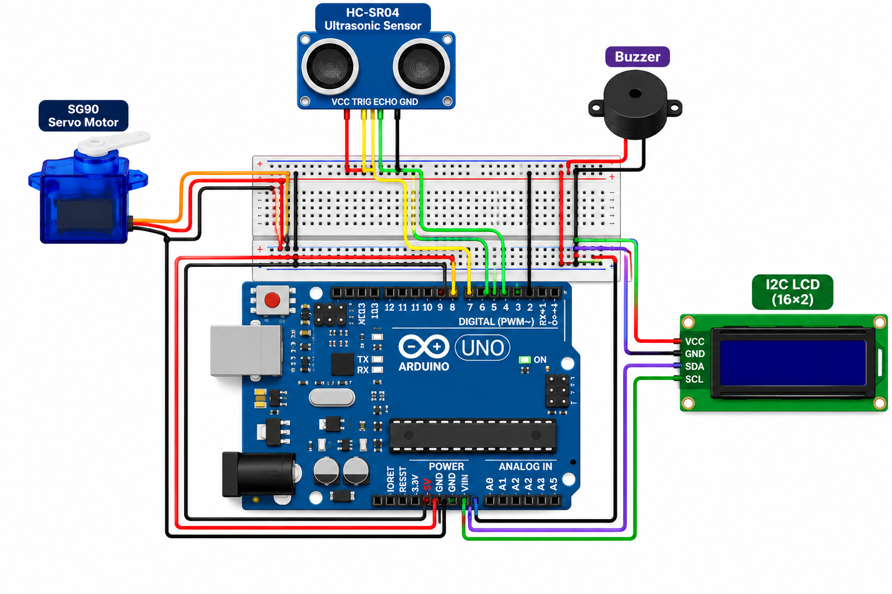

<p align="center">
  
</p>

<h1 align="center">TACTICAL RADAR SYSTEM</h1>

<p align="center">
  <strong>An advanced real-time ultrasonic radar detection system with hardware servo scanning, target tracking lock, tactical rapid-fire alerts, I2C LCD status telemetry, and a military-grade Processing GUI HUD.</strong>
</p>

<p align="center">
  <a href="https://www.arduino.cc/en/software/">
    
  </a>
  <a href="https://processing.org/download">
    
  </a>
  
  
  
  
</p>

<p align="center">
  <a href="https://www.arduino.cc/en/software/">
    
  </a>
  &nbsp;&nbsp;
  <a href="https://processing.org/download">
    
  </a>
</p>

---

## Table of Contents

- [Overview](#overview)
- [Key Features](#key-features)
- [How It Works](#how-it-works)
- [System Architecture & File Breakdown](#system-architecture--file-breakdown)
- [Hardware Components](#hardware-components)
- [Circuit & Pin Connections](#circuit--pin-connections)
- [Installation & Setup](#installation--setup)
  - [1. Arduino IDE Setup](#1-arduino-ide-setup)
  - [2. Processing IDE Setup](#2-processing-ide-setup)
- [Configuration & Tuning](#configuration--tuning)
- [Troubleshooting](#troubleshooting)
- [License](#license)

---

## Overview

The **Tactical Radar System** is an embedded hardware-software telemetry platform that replicates modern military radar scanning and fire-control target locking on a desktop workstation.

The system combines physical sensor actuation via an **Arduino microcontroller** with a customized military heads-up display (HUD) running in **Processing**. As the radar sweeps back and forth across a 180-degree field of view, an ultrasonic rangefinder continuously calculates obstacle distance. When a target is detected within threat range, the radar mechanism locks onto the target angle, fires an acoustic machine-gun warning sequence, updates an on-board I2C LCD character display, and highlights the target location on the PC HUD with animated lock reticles and phosphor persistence trails.

---

## Key Features

- **180° Panoramic Servo Sweep:** Smooth bi-directional physical sweep driven by an SG90 servo motor with fine speed control.
- **Precision Ultrasonic Rangefinding:** Fast HC-SR04 pulse timing measuring obstacle distances from 2 cm to 200 cm.
- **Intelligent Target Confirmation Filter:** Multi-sample verification (3 consecutive hits) to eliminate false positives and echo noise.
- **Physical Target Lock:** Automatically pauses the servo sweep and holds orientation at the detected threat angle until the target clears.
- **Tactical Machine-Gun Warning Buzzer:** Non-blocking rapid alert cadence (45 ms ON / 45 ms OFF) triggered immediately upon confirmed target acquisition.
- **Standalone I2C LCD Status Display:** Real-time character telemetry (`Scanning !!` vs `Object Detected !!`) powered by custom software bit-banged I2C.
- **Phosphor Persistence CRT HUD:** High-resolution Processing GUI with 60 FPS rendering, phosphor decay glow, sweeping sweep line, distance range rings, and dynamic targeting crosshairs.
- **Clean Serial Communication:** Standardized serial telemetry pipeline (`<angle>,<distance>\n`) operating reliably over 9600 baud.

---

## How It Works

```
  +-------------------------------------------------------------+
  |                   HARDWARE SCANNING LOOP                   |
  +-------------------------------------------------------------+
         |
         v
   [ Servo Sweep ] ---> [ HC-SR04 Echo Measure ] ---> [ Confirmation Filter ]
  (0° to 180° Scan)      (Pulse Duration to cm)       (3 Hits = Confirmed)
                                                              |
                 +--------------------------------------------+
                 |
                 +---> TARGET CONFIRMED?
                           |
            +--------------+--------------+
            |                             |
         [ YES ]                       [ NO ]
            |                             |
            v                             v
  * Lock Servo at Angle         * Step Servo Angle (0°-180°)
  * Rapid Machine-Gun Buzz      * Reset Buzzer
  * LCD: "Object Detected !!"   * LCD: "Scanning !!"
  * Send: <angle>,<distance>    * Send: <angle>,<distance>
            |                             |
            +--------------+--------------+
                           |
                           v
                [ Serial Communication ]
                    (USB @ 9600 Baud)
                           |
                           v
  +-------------------------------------------------------------+
  |              PROCESSING DESKTOP GUI INTERFACE               |
  |  * Green Phosphor Sweep     * Target Lock Reticle Ring      |
  |  * Radar Grid & Range Rings * Real-time Distance/Angle HUD  |
  +-------------------------------------------------------------+
```

1. **Physical Actuation:** The Arduino drives the SG90 servo motor in 1-degree increments from 0° to 180° and reverses direction at the boundary.
2. **Pulse Echo Measurement:** At each step, a 10 µs pulse triggers the HC-SR04 ultrasonic sensor. Return echo time is converted into centimeters via acoustic velocity ($d = t \times 0.0343 / 2$).
3. **Filtering & Hysteresis:** Raw readings are evaluated against threshold limits. To prevent false alarms from stray echoes, a target must register 3 consecutive times within `ALERT_CM` (16 cm) before triggering state lock. An object is only released when absent for 3 consecutive readings past `RELEASE_CM` (19 cm).
4. **Target Lock & Alert:** When a target is confirmed:
   - The servo stops sweeping and maintains its fixed bearing.
   - The buzzer executes a rapid machine-gun pulse warning pattern.
   - The 16x2 LCD switches from `Scanning !!` to `Object Detected !!`.
5. **PC Telemetry Pipeline:** The Arduino outputs raw ASCII data strings formatted as `angle,distance\n` over the USB serial port.
6. **Processing Visual HUD:** The desktop Processing sketch parses incoming serial frames, computes polar-to-Cartesian coordinates, renders glowing radar rings, draws a phosphor persistence trail, and paints an animated red target lock reticle over active contacts.

---

## System Architecture & File Breakdown

The repository contains two primary source files responsible for the embedded firmware and the desktop visualization interface:

| File / Folder | Role | Environment | Purpose |
| :--- | :--- | :--- | :--- |
| **`radar_arduino/radar_arduino.ino`** | Embedded Firmware | Arduino IDE | Direct hardware control: sweeps the servo, polls the ultrasonic sensor, performs software I2C communication to the LCD, pulses the buzzer alert, handles target lock state, and streams serial telemetry. |
| **`RadarSystem_pde.pde`** | Tactical Desktop GUI | Processing 4 | Reads serial data at 9600 baud, renders the circular radar screen, creates phosphor sweep trail effects, draws distance rings (10cm, 20cm, 30cm, 40cm), and provides interactive HUD targeting data. |
| **`sketch.properties`** | Processing Config | Processing IDE | Configuration file designating the main entrypoint file for the Processing runtime. |
| **`assets/circuit-diagram.png`** | Hardware Schematic | Image Viewer | Complete visual wiring schematic illustrating the wiring between Arduino Uno, HC-SR04, SG90, buzzer, and I2C LCD. |
| **`assets/header-framed.png`** | Framed Hardware Showcase | Image Viewer | Pre-rendered static framed showcase of the Tactical Radar System hardware prototype. |
| **`assets/header-frame.svg`** | Tactical Vector Frame | SVG / Vector | Scalable vector tactical telemetry frame design with status indicators. |

---

## Hardware Components

| Component | Specification | Quantity | Purpose |
| :--- | :--- | :---: | :--- |
| **Arduino Uno** | ATmega328P, 16 MHz, 5V Logic | 1 | Central controller executing sensor loops, filtering, and telemetry |
| **HC-SR04 Ultrasonic Sensor** | Range: 2 cm – 400 cm, 5V DC | 1 | Distance measuring rangefinder mounted on the rotating servo arm |
| **SG90 Micro Servo** | 180° rotation, 4.8V–6V DC | 1 | Mechanical actuator rotating sensor across the scanning arc |
| **Active / 5V Buzzer** | 5V Piezoelectric Buzzer | 1 | Acoustic alarm providing tactical rapid-fire alerts upon detection |
| **16x2 Character LCD** | 1602 HD44780 with PCF8574 I2C | 1 | On-board hardware text display providing instant status telemetry |
| **Solderless Breadboard** | 400 or 830 tie-points | 1 | Power distribution and circuit prototyping base |
| **Jumper Wires** | Male-to-Male, Male-to-Female | Set | Interconnecting components, sensor headers, and Arduino pins |
| **USB Cable** | USB Type-A to Type-B | 1 | Programming interface, serial telemetry line, and 5V power supply |

---

## Circuit & Pin Connections

<p align="center">
  
</p>

The following pin allocation table is extracted directly from the embedded firmware (`radar_arduino/radar_arduino.ino`). Follow these exact connections to wire your hardware:

| Subsystem / Module | Module Pin | Arduino Uno Pin | Mode | Description |
| :--- | :--- | :--- | :--- | :--- |
| **HC-SR04 Sensor** | **VCC** | **5V** | Power | 5V DC supply rail |
| | **GND** | **GND** | Power | Ground rail |
| | **TRIG** | **D5** | Digital Output | Ultrasonic trigger pulse pin |
| | **ECHO** | **D6** | Digital Input | Ultrasonic echo pulse receive pin |
| **SG90 Servo Motor** | **VCC (Red)** | **5V** | Power | 5V DC supply rail |
| | **GND (Brown/Black)** | **GND** | Power | Ground rail |
| | **PWM Signal (Orange/Yellow)** | **D9** | Digital PWM Out | Servo angle pulse control signal |
| **Warning Buzzer** | **Positive (+)** | **D4** | Digital Output | 45ms rapid pulse alarm trigger |
| | **Negative (-)** | **GND** | Power | Ground rail |
| **16x2 I2C LCD** | **VCC** | **5V** | Power | 5V DC supply rail |
| | **GND** | **GND** | Power | Ground rail |
| | **SDA** | **D2** | Software I2C | Bit-banged I2C Serial Data line |
| | **SCL** | **D12** | Software I2C | Bit-banged I2C Serial Clock line |

> [!NOTE]
> **Custom Software I2C:** This firmware employs custom bit-banged I2C on digital pins **D2** and **D12** (rather than default analog pins A4/A5). The code automatically scans and auto-detects both standard LCD backpack I2C addresses (`0x27` and `0x3F`).

---

## Installation & Setup

### Prerequisites

Ensure you have both the Arduino IDE and Processing installed on your computer:

- **Arduino IDE:** [Download from Official Arduino Portal](https://www.arduino.cc/en/software/) (Version 2.x recommended)
- **Processing IDE:** [Download from Official Processing Foundation](https://processing.org/download) (Version 4.x recommended)

---

### 1. Arduino IDE Setup

1. **Connect Hardware:** Wire all components according to the [Circuit & Pin Connections](#circuit--pin-connections) table.
2. **Connect to PC:** Plug the Arduino Uno into your computer using the USB Type-A to Type-B cable.
3. **Open the Project:**
   - Launch **Arduino IDE**.
   - Navigate to `File` > `Open...` and select `radar_arduino/radar_arduino.ino`.
4. **Select Board & Port:**
   - Under `Tools` > `Board`, select **Arduino Uno**.
   - Under `Tools` > `Port`, select the active COM port corresponding to your connected Arduino (e.g., `COM3`, `COM4`).
5. **Verify Built-in Library:**
   - The sketch requires `<Servo.h>`, which is bundled by default in the Arduino IDE core.
6. **Upload Firmware:**
   - Click the **Upload** button (arrow icon) in the toolbar.
   - Wait for the message: `Done uploading.`
   - Observe the 16x2 LCD screen: it will display `Radar Ready!` followed by `Scanning !!`.
   - The servo motor will begin its 0° to 180° sweep.

> [!IMPORTANT]
> Keep the **Serial Monitor in Arduino IDE closed** after verifying, as Processing requires exclusive access to the serial port.

---

### 2. Processing IDE Setup

1. **Launch Processing:**
   - Open the **Processing** application on your workstation.
2. **Open the Radar HUD Sketch:**
   - Go to `File` > `Open...` and open `RadarSystem_pde.pde`.
3. **Verify Serial Port Index:**
   - In `RadarSystem_pde.pde`, locate line 104:
     ```java
     myPort = new Serial(this, Serial.list()[0], 9600);
     ```
   - When the sketch runs, it prints all available serial ports in the console window (`Serial.list()`).
   - If your Arduino is not the first connected device, update the index `[0]` to match the correct port index (e.g., `[1]`, `[2]`).
4. **Run the Radar HUD:**
   - Click the **Run** button (play icon) in the Processing IDE toolbar.
   - The high-resolution tactical radar window (`1200 x 750`) will launch.
   - The sweep line will track the physical servo movement in real-time.
   - When an object enters within threat distance, a target lock box will highlight the object bearing and distance with full tactical telemetry.

---

## Configuration & Tuning

Both the Arduino firmware and Processing HUD can be tuned to suit your detection environment:

### Firmware Tuning (`radar_arduino.ino`)

| Variable | Default Value | Description |
| :--- | :---: | :--- |
| `ALERT_CM` | `16` | Threshold distance (in cm) required to trigger target detection |
| `RELEASE_CM` | `19` | Hysteresis distance (in cm) required before an acquired target is released |
| `MAX_CM` | `200` | Ultrasonic sensor maximum reading ceiling |
| `SERVO_SPEED_MS` | `20` | Delay in milliseconds per degree step; increase for slower sweep, decrease for faster sweep |
| `DETECT_CONFIRM_COUNT` | `3` | Number of consecutive matching reads required to confirm target acquisition |
| `CLEAR_CONFIRM_COUNT` | `3` | Number of consecutive clear reads required to exit target lock mode |
| `BUZZ_ON_MS` | `45` | Duration (ms) buzzer remains HIGH during rapid warning pulse |
| `BUZZ_OFF_MS` | `45` | Duration (ms) buzzer remains LOW between warning pulses |

### GUI Tuning (`RadarSystem_pde.pde`)

| Variable | Default Value | Description |
| :--- | :---: | :--- |
| `maxDistance` | `40` | Maximum radar range plotted on the screen (in cm) |
| `sweepSpeed` | `0.24` | Software sweep smoothing interpolation rate |
| `trailSteps` | `55` | Number of phosphor trail decay steps for phosphor persistence glow |
| `size(1200, 750)` | `1200 x 750` | HUD window resolution; adjustable for different display sizes |

---

## Troubleshooting

### LCD Displays Nothing / Blank Screen
- **Backlight & Contrast:** Adjust the small blue potentiometer screw on the back of the I2C backpack using a precision screwdriver until character blocks become clearly visible.
- **I2C Address Conflict:** The firmware automatically attempts addresses `0x27` and `0x3F`. If your I2C expander uses an alternate address (e.g., `0x20`), modify `addrs[]` in `findLcd()`.
- **Wiring Verification:** Ensure SDA is wired to **D2** and SCL is wired to **D12** as specified in firmware.

### Processing Shows "Port Busy" or "Connection Failed"
- **Close Arduino Serial Monitor:** Ensure the Serial Monitor or Serial Plotter in the Arduino IDE is completely closed before launching Processing. Only one application can read the COM port at a time.
- **Port Index Mismatch:** Check the Processing console output upon startup. Identify which index corresponds to your Arduino COM port and update `Serial.list()[0]`.

### Servo Motor Stutters or Resets Arduino
- **Current Brownout:** When powered solely by some PC USB ports, servo current spikes can cause the Arduino 5V rail to drop momentarily, resetting the ATmega328P. Connect an external 5V 1A–2A power supply to the servo power rails, sharing a common ground with the Arduino.

### Erratic Distance Readings
- **Reflective Angles:** Ultrasonic sensors require flat or rigid surfaces to reflect sound pulses cleanly. Soft fabrics or steep angles absorb or deflect acoustic waves.
- **Minimum Distance:** HC-SR04 sensors have a physical blind zone under 2 cm; keep obstacles at least 3 cm away from the sensor face.

---

## License

This project is licensed under the [MIT License](LICENSE). You are free to modify, distribute, and integrate this software and hardware design in personal, academic, and commercial applications.
